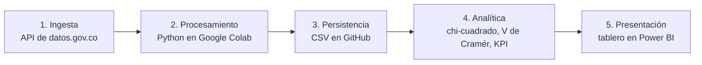

# Deserción académica de pregrado en una institución de educación superior de Boyacá, 2020-2025

Proyecto de grado de la Especialización en Analítica de Datos (CUN), curso Proyecto 2.
Autor: Jairo Andrés Orrego Claros · Director: Andrés Felipe Solís Pino.

## Objetivo

Desarrollar un análisis de la deserción académica de pregrado (pérdida de cupo por rendimiento académico) en una
institución de educación superior de Boyacá, en el periodo 2020-2025, mediante técnicas de analítica de datos, como
apoyo al fortalecimiento de la gestión institucional y de las estrategias de permanencia. El estudio es descriptivo
y sigue la metodología CRISP-DM.

## Datos

- **Fuente:** Universidad Pedagógica y Tecnológica de Colombia (2025). *Deserción académica pregrado y posgrado*
  [Conjunto de datos]. Portal de Datos Abiertos de Colombia. https://www.datos.gov.co/d/3iew-7wpx
- **Licencia de los datos:** CC BY-SA 4.0. Los datos derivados de este repositorio se publican bajo la misma licencia.
- **Tamaño:** 3.372 registros y 13 columnas en la fuente; 3.091 registros de pregrado después de la ETL.
- La base no contiene nombres ni números de documento. En la ETL se excluyeron el tipo de identificación, el lugar
  de expedición y la fecha de nacimiento exacta (que se transformó en edad y rango de edad).

## Estructura

```
├── README.md
├── notebooks/        cuadernos de Google Colab (ACA 1 y ACA 2)
├── data/
│   ├── raw/          enlace y código de descarga de la fuente
│   └── processed/    base limpia, base del ACA 2 y modelo estrella (1 tabla de hechos + 6 dimensiones)
├── results/
│   ├── tables/       tablas de resultados en CSV (ETL, diccionario, selección, pruebas, KPI, validación, calidad)
│   ├── figures/      figuras del documento
│   └── experiments.csv  una fila por corrida: fecha, cuaderno, parámetros, semilla y resultado
├── dashboard/        tablero de Power BI (.pbix)
├── requirements.txt  versiones de las librerías
└── LICENSE           licencia MIT del código
```

## Cómo reproducir los resultados

Cuadernos en Google Colab (solo lectura):

- ACA 1 (ETL y EDA): https://colab.research.google.com/drive/1a0DUz9_L0Y7MGKslB-zcXdlnLU2NX86T?usp=sharing
- ACA 2 (características, pruebas, modelo dimensional y KPI): https://colab.research.google.com/drive/1IB5YbhyJ1wt5MLLVADcRSXKTF2O3xowz?usp=sharing

1. Abrir en Google Colab el cuaderno `notebooks/Desercion_academica_ETL_EDA.ipynb` (ACA 1) y ejecutarlo completo
   (**Entorno de ejecución › Ejecutar todas**). Descarga los datos de la API y genera la base limpia.
2. Abrir `notebooks/Desercion_academica_ACA2.ipynb` (ACA 2) y ejecutarlo completo. Lee la base limpia desde este
   repositorio (versión v0.1) y genera las tablas de `results/tables` y el modelo estrella.
3. Abrir `dashboard/ACA2_Proyecto2_Tablero.pbix` en Power BI Desktop. El tablero usa los CSV de
   `data/processed/modelo_estrella`.

La semilla está fijada en 42 (`SEMILLA = 42`), por lo que la selección de variables y los intervalos bootstrap
se reproducen igual. Ninguna cifra del documento de grado se escribió a mano: todas salen de `results/tables`.

## Arquitectura de la solución



## Resultados principales (ACA 2)

- **Ingeniería de características:** 6 variables derivadas; la información mutua seleccionó 6 de 9 variables
  candidatas (umbral 0,01).
- **Pruebas de hipótesis (α = 0,05):** se rechazaron H1, H2 y H3 (p < 0,001), con asociaciones débiles
  (V de Cramér entre 0,09 y 0,14; ningún IC 95 % bootstrap incluyó el cero).
- **KPI:** las tres facultades con más registros reúnen el 63,2 % de la pérdida de cupo (2,7 veces lo esperado con
  un reparto uniforme); los 10 programas principales, el 38,6 %.
- **Validación:** la fuente, la tabla de hechos, las seis dimensiones y el tablero coinciden en 3.091 registros
  (diferencia 0).
- **Calidad de los datos:** 9 limitaciones documentadas; la principal es que la base no incluye el número de
  matriculados, por lo que no permite calcular tasas de deserción.

## Entorno de cómputo

- Google Colab, máquina estándar con CPU (sin GPU).
- Python 3.13.18 (Linux). Librerías y versiones en `requirements.txt` (pandas, NumPy, SciPy, scikit-learn,
  matplotlib, seaborn).
- Tiempo de ejecución completa del cuaderno del ACA 2: 53 segundos. El estudio es descriptivo: no se entrenan
  modelos predictivos.

## Versiones

| Entrega | Etiqueta | Contenido |
|---|---|---|
| ACA 1 | v0.1 | ETL, diccionario de datos y EDA |
| ACA 2 | v0.2 | Ingeniería de características, pruebas de hipótesis, calidad de los datos, modelo dimensional, KPI y tablero |

## Licencia

El código se publica bajo la licencia MIT (ver `LICENSE`). Los datos originales y derivados conservan la licencia
CC BY-SA 4.0 de la fuente.
